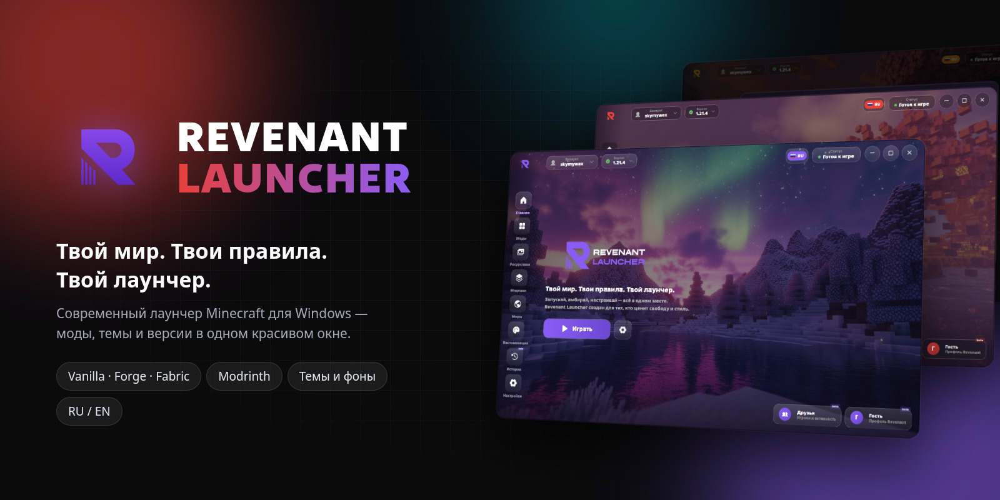
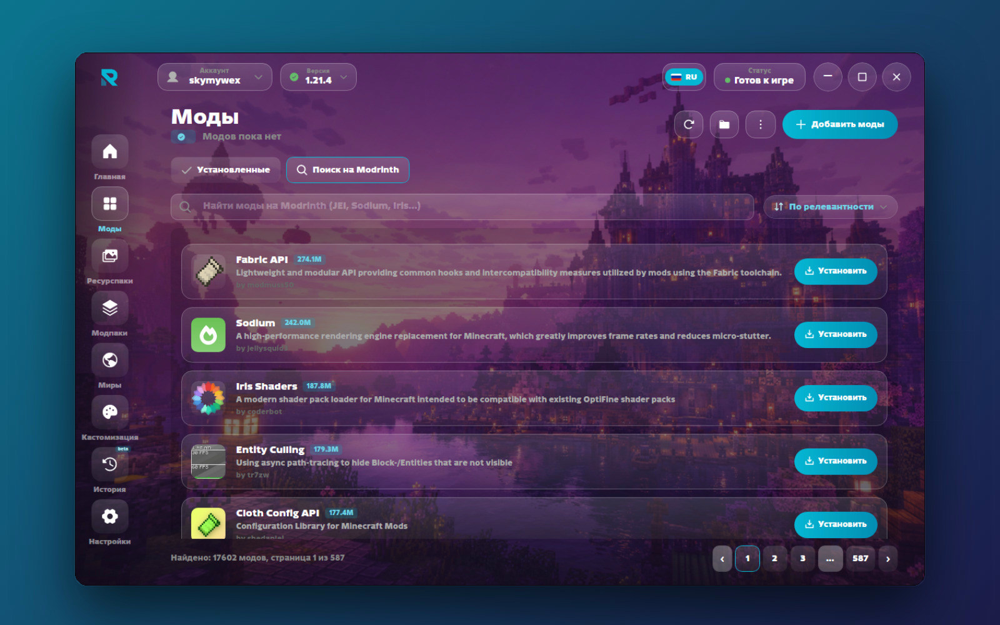
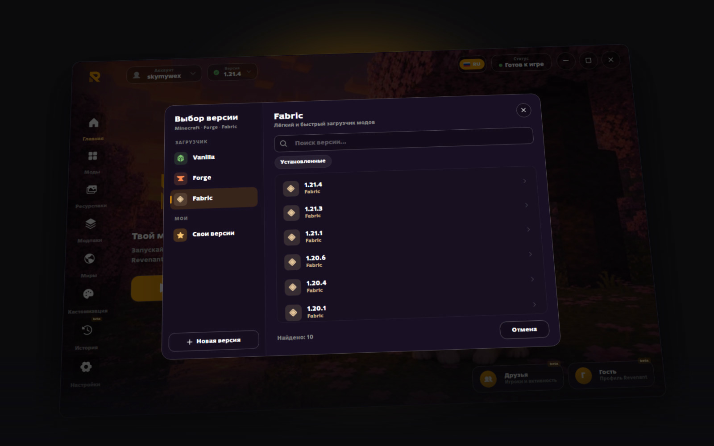
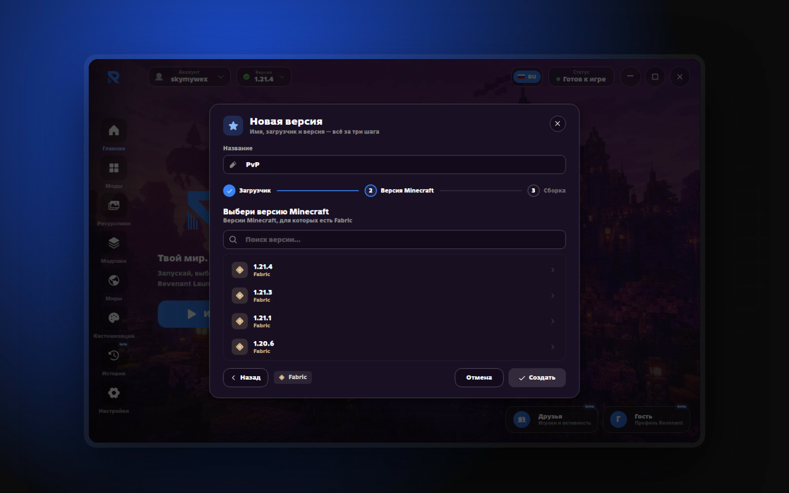
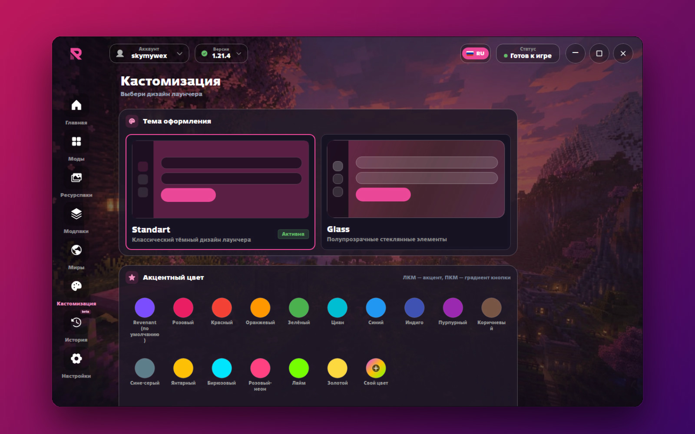
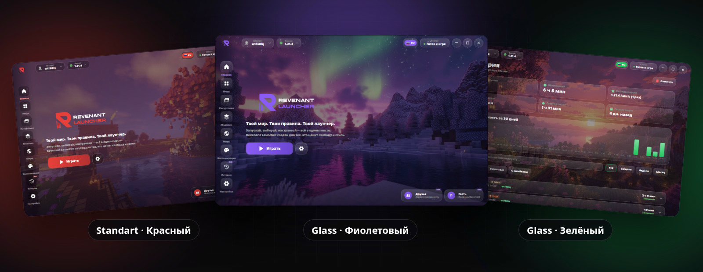

 

  

 

<b><a href="#-возможности">Возможности</a></b> &nbsp;•&nbsp;
<b><a href="#-скриншоты">Скриншоты</a></b> &nbsp;•&nbsp;
<b><a href="#-один-лаунчер--любой-стиль">Стили</a></b> &nbsp;•&nbsp;
<b><a href="#-установка">Установка</a></b> &nbsp;•&nbsp;
<b><a href="#-вопросы">Вопросы</a></b>

 

## ✨ Возможности

<table>
<tr>
<td width="33%" valign="top">

### 🚀 Запуск в один клик
Vanilla, Forge и Fabric — ставятся сами. Нужная Java подбирается автоматически, версии не мешают друг другу.

</td>
<td width="33%" valign="top">

### 🧩 Моды из Modrinth
Поиск, установка и обновление модов, ресурспаков и модпаков прямо в лаунчере — с фильтрами по версии и загрузчику.

</td>
<td width="33%" valign="top">

### 🎨 Твой дизайн
Темы **Standart** и **Glass**, 17 акцентных цветов, свой цвет и градиенты, свои фоны — картинки, GIF и видео.

</td>
</tr>
<tr>
<td width="33%" valign="top">

### 🗂️ Свои сборки
Мастер «Новая версия»: название → загрузчик → версия. Сборки с модами переключаются в пару кликов.

</td>
<td width="33%" valign="top">

### 🌍 Миры и скриншоты
Список миров, бэкапы одной кнопкой, быстрая галерея скриншотов с превью.

</td>
<td width="33%" valign="top">

### 👥 Друзья и история
Аккаунты Revenant, друзья и активность, история игровых сессий со статистикой, Discord Rich Presence.

</td>
</tr>
</table>

 

## 📸 Скриншоты

### Каталог модов
Тысячи модов из Modrinth — установка в одно нажатие

  

### Выбор версии
Vanilla, Forge, Fabric и свои сборки — в одном меню

  

### Новая версия
Создание сборки по шагам — без лишних настроек

  

### Кастомизация
Тема, акцент, фон, цвета интерфейса и пресеты

 

## 🌈 Один лаунчер — любой стиль

 
Выбери тему, цвет и фон — интерфейс перекрасится целиком, вплоть до логотипа.

 

## 📦 Установка

| Шаг | Что сделать |
|:--:|---|
| **1** | Скачай `RevenantLauncherSetup-vX.Y.Z.exe` со страницы [последнего релиза](https://github.com/wtf40iq/RevenantReleases/releases/latest) |
| **2** | Запусти установщик — он сам развернёт лаунчер и создаст ярлык |
| **3** | Войди в аккаунт, выбери версию и жми **Играть** |

> [!TIP]
> Обновления приходят сами: лаунчер скачивает новую версию в фоне и предлагает установить её сейчас или при следующем запуске. Аккаунты, настройки и миры сохраняются.

### Требования

| | |
|---|---|
| **Система** | Windows 10 / 11 (x64) |
| **Java** | не нужна — подберётся автоматически |
| **Интернет** | для входа, загрузки версий и модов |

 

## ❓ Вопросы

<b>Какие аккаунты поддерживаются?</b>

 
Аккаунт Microsoft и офлайн-аккаунт для игры. Отдельно — профиль Revenant для друзей, чата и активности: он создаётся прямо в лаунчере.

<b>Windows ругается на установщик (SmartScreen)</b>

 
Это обычное предупреждение для новых программ без дорогой подписи. Нажми «Подробнее» → «Выполнить в любом случае». Скачивай установщик только со страницы <a href="https://github.com/wtf40iq/RevenantReleases/releases">Releases</a>.

<b>Где хранятся мои миры и моды?</b>

 
В папке игры лаунчера — открыть её можно из настроек. При обновлении лаунчера ничего не удаляется.

<b>Нашёл баг или есть идея</b>

 
Создай <a href="https://github.com/wtf40iq/RevenantReleases/issues">Issue</a> — опиши, что случилось, и приложи скриншот.

 

## 📝 Что нового

Полная история изменений — в [Releases](https://github.com/wtf40iq/RevenantReleases/releases). Последнее обновление **0.7.0**: новое меню версий и мастер «Новая версия», единые иконки, быстрые скриншоты, интерфейс в цветах темы и усиленная защита входа.

 

© 2026 lotesnowhallen · Revenant Launcher · Не является официальным продуктом Minecraft. Не связан с Mojang или Microsoft.

